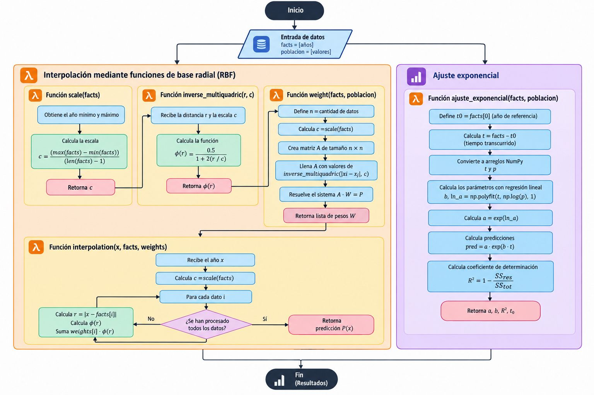

# MathProject: crecimiento de la población con RBF

Integrantes: JHOAN ALEXIS DAVID - CRISTIAN URRESTI

Estima la población de un año **dentro del rango de los datos conocidos** usando
interpolación con una **función de base radial (RBF)** de tipo *multicuadrática
inversa*, y la compara con un ajuste exponencial de referencia. Incluye una
interfaz gráfica para ingresar los datos, ver la curva y predecir un año.

## Cómo funciona

Dados los años `facts = [x₁, …, xₙ]` y la población de cada año `P = [p₁, …, pₙ]`:

1. **Kernel (RBF):** `φ(r) = 1 / √(1 + (r / c)²)`, donde `c = (max − min) / (n − 1)`
   es la separación promedio entre años.
2. **Matriz A:** `A[i][j] = φ(|xᵢ − xⱼ|)`. Es simétrica, así que solo se calcula
   la mitad y se copia al otro lado.
3. **Pesos:** se resuelve el sistema `A · W = P` con `numpy.linalg.solve`
   (no se calcula la inversa de forma explícita).
4. **Predicción:** `f(x) = Σ Wᵢ · φ(|x − xᵢ|)`. La curva pasa exactamente por
   cada dato conocido.
5. **Referencia:** `ajuste_exponencial` ajusta `P(t) = a · e^(b·(t − t₀))`
   mediante regresión lineal sobre `ln P` y calcula el R².

## Diagrama de flujo



## Estructura

| Archivo | Contenido |
|---|---|
| `main.py` | Lógica: `scale`, `inverse_multiquadric`, `weight`, `interpolation`, `ajuste_exponencial` |
| `ui.py` | Interfaz gráfica (Tkinter + Matplotlib); importa la lógica de `main.py` |
| `docs/diagrama_flujo.jpg` | Diagrama de flujo del código |

## Instalación y uso

Requiere Python 3.9 o superior. Tkinter viene incluido con Python en Windows y macOS.

```bash
pip install -r requirements.txt
python ui.py
```

En la ventana:

1. Escribe los años y la población de cada año, separados por coma.
2. Pulsa **Graficar** para ver la curva RBF, los datos y la exponencial de referencia.
3. Escribe un año y pulsa **Predecir** para ver la población estimada.

### Usar solo la lógica

```python
from main import weight, interpolation

facts = [2005, 2010, 2015]
poblacion = [41468384, 44777319, 46314000]

w = weight(facts, poblacion)
print(interpolation(2012, facts, w))   # ≈ 46.2 millones
```

## Limitaciones

- Solo es fiable para años entre el primero y el último de `facts`. Fuera de ese
  rango el kernel decae hacia 0 y la predicción deja de ser realista.
- Los años no pueden repetirse (la matriz A dejaría de tener inversa).
- Con pocos datos la curva puede pasarse un poco de los valores medidos entre dos
  puntos consecutivos.
- La exponencial de referencia exige población mayor que 0.
